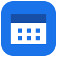

# Google Calendar Desktop Widget

**Your Google Calendar, living on your desktop.**
Transparent. Click-through. Always up to date. Never in the way.

🌐 **[Website](https://mkazemie.github.io/google-calendar-desktop-widget/)** · 📥 **[Download](https://github.com/mkazemie/google-calendar-desktop-widget/releases/download/v1.3.0/CalendarWidgetSetup-1.3.0.exe)**

## Your schedule, always one glance away

Stop alt-tabbing to check what's next. Google Calendar Desktop Widget pins the **real Google Calendar** straight onto your desktop wallpaper — softly transparent, pinned beneath all your windows, and completely invisible to your mouse. You click, drag, and work right *through* it, like it's part of the background. Or tuck it **behind your desktop icons** and it becomes a live wallpaper.

And because it's the live Google Calendar — not a copy — **it updates in real time**. Add an event from your phone, accept an invite on your laptop, and watch it appear on your desktop seconds later.

## ✨ Why you'll love it

- 🪟 **Truly click-through** — clicks, drags, even *right-clicks* land on whatever is behind it: desktop icons, files, the wallpaper menu. Zero interference.
- 🔄 **Live, not a snapshot** — it *is* Google Calendar, synced across all your devices in real time.
- ✏️ **Edit in place** — one click on the title bar makes it a normal window: add events, drag meetings around, then toggle back.
- 🖼️ **Live-wallpaper mode** — tuck the calendar *behind your desktop icons*; the icons sit on top of your schedule and stay clickable.
- 🌫️ **Edge shadows** — soft dark fades on the calendar's left and right edges keep desktop icons readable, even over a busy week.
- 🌗 **Matches your calendar** — light or dark, the title bar and window frame follow Google Calendar's own theme automatically.
- 👻 **As subtle as you want** — transparency from 0 to 95 %, so it melts into your wallpaper. Every change previews live.
- 📌 **Stays in the background** — pinned to the bottom; it never pops over your work, never steals focus, never interrupts a game or a full-screen video.
- 🖥️ **Feels native** — snap it, maximize it, drag it between monitors like any Windows 11 app. Sharp at every display scale.
- 🚀 **Set and forget** — starts with Windows, sits quietly in the tray, remembers your sign-in.

## 🖱️ One button, two modes

In widget mode the title bar shrinks to just its two buttons and everything else lets your clicks through. The mouse button **stays clickable** — flipping back to a full, editable calendar is always exactly one click away.

## 👆 Yes — even right-click goes through

The widget is completely invisible to your mouse. Right-click your wallpaper and Windows answers, not the calendar — the desktop context menu opens straight through it, exactly as if the calendar weren't there.

## 🖼️ Make it your live wallpaper

Turn on **Sit behind desktop icons** and, in widget mode, the calendar slides under your desktop icons — just like a wallpaper. Add **edge shadows** and the icon labels stay crisp on top of your schedule. The title-bar buttons stay above the icons, so editing is still one click away.

## 🌗 Light or dark — it matches your calendar

Switch Google Calendar to dark mode in its own settings (gear icon) and the widget's title bar, window frame and hover panel follow within a second. Nothing to set up in the widget.

## 🎛️ A tiny control panel runs everything

Transparency, live-wallpaper mode, edge shadows, hover-panel corner, start-with-Windows, sign-out — all in one small panel. Changes preview live as you drag.

## 📥 Get it

1. **[Download the latest installer](https://github.com/mkazemie/google-calendar-desktop-widget/releases/download/v1.3.0/CalendarWidgetSetup-1.3.0.exe)** (≈ 2 MB) and run it — it fetches anything else it needs automatically.
2. **Sign in** to your Google account on first launch.
3. Hit the **mouse button** in the title bar — your calendar fades into the desktop. Done.

> Works on Windows 11 and Windows 10. Free forever. See what changed in each version in the [release notes](https://github.com/mkazemie/google-calendar-desktop-widget/releases).

## ❤️ Support the project

Calendar Widget is free and always will be. If it earns a permanent spot on your desktop, you can fuel its development:

**[☕ Donate via PayPal](https://paypal.me/MahdiKazemiesfahani)**

## License & commercial use

© 2026 Mahdi Kazemiesfahani.

Google Calendar Desktop Widget is free and open source under the **[GNU Affero General Public License v3.0](LICENSE)**. You may use, study, modify, and share it — as long as you keep it open source under the same license and credit the author.

**Building it into a proprietary or commercial product** (or any closed-source derivative)? The AGPL requires you to either release your product's full source under the AGPL, or obtain a separate commercial license. To discuss commercial licensing, reach out:

📧 **Mahdi Kazemiesfahani — [m.kazemi.esfahani@gmail.com](mailto:m.kazemi.esfahani@gmail.com)**

*This is an unofficial, independent project — not affiliated with or endorsed by Google. Google Calendar is a trademark of Google LLC.*
